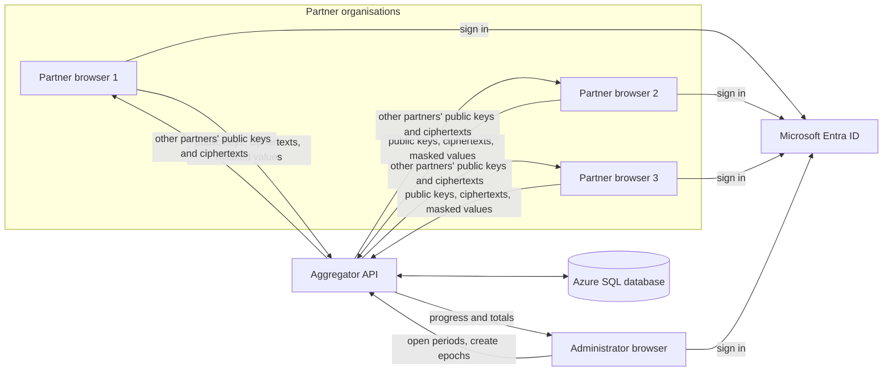
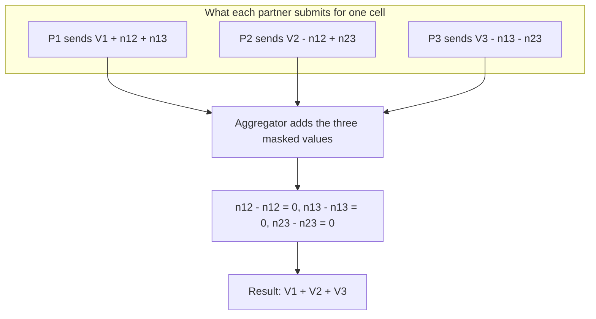
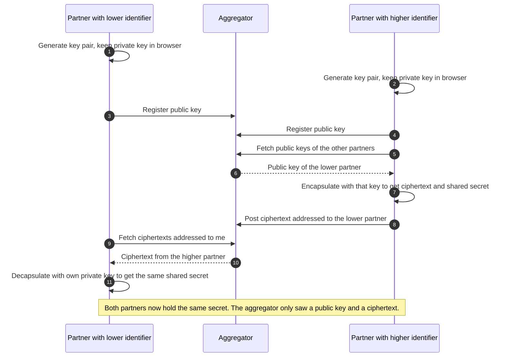
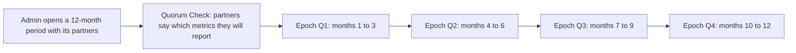
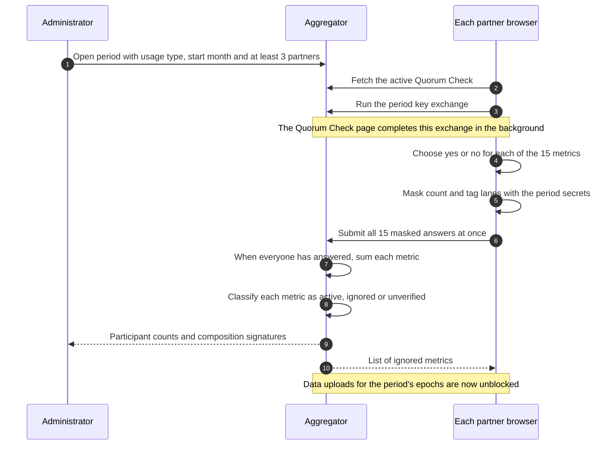
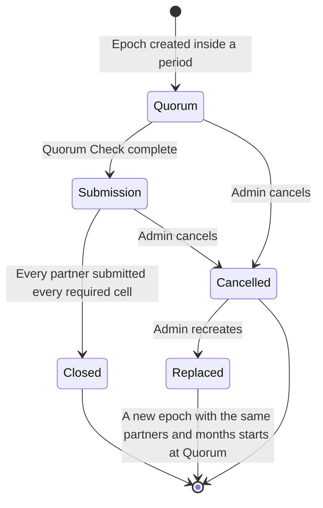
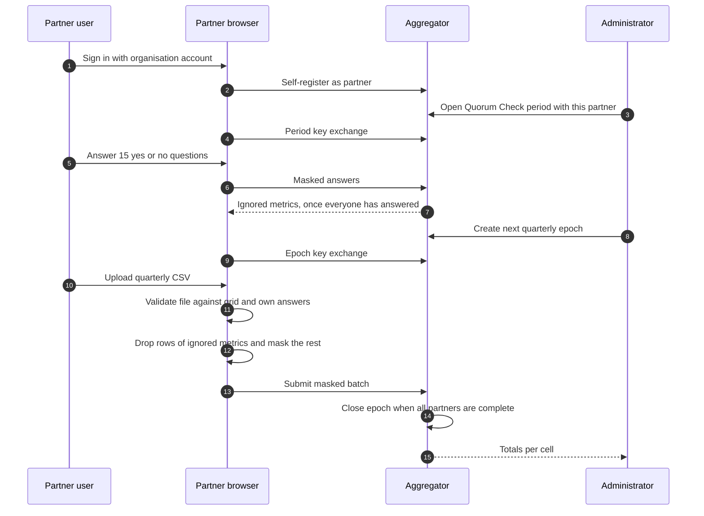

# Privacy-Preserving Secure Aggregation

This service lets several data partners combine sensitive figures into shared statistics without any party, including the service that collects them, seeing an individual partner's numbers. Each partner hides its values behind random-looking masks before they leave its browser. The masks are built in pairs so that they cancel out exactly when everyone's values are added together. The aggregator therefore learns only totals.

The pairwise masks come from shared secrets that partners agree on through the aggregator using ML-KEM-768. ML-KEM is the post-quantum key encapsulation mechanism standardised by NIST as FIPS 203. The aggregator relays the key material but cannot work out any secret from it. Partners sign in with Microsoft Entra ID. The aggregator is an ASP.NET Core API backed by Azure SQL. Partners and administrators use it through a separate browser application.

---

## Contents

1. [The problem](#the-problem)
2. [Solution at a glance](#solution-at-a-glance)
3. [How the masking works](#how-the-masking-works)
4. [Key agreement with ML-KEM-768](#key-agreement-with-ml-kem-768)
5. [Usage types, the reporting grid and the timeline](#usage-types-the-reporting-grid-and-the-timeline)
6. [The Quorum Check](#the-quorum-check)
7. [Epoch lifecycle](#epoch-lifecycle)
8. [The partner journey end to end](#the-partner-journey-end-to-end)
9. [The administrator journey and aggregation](#the-administrator-journey-and-aggregation)
10. [Security model](#security-model)
11. [Authentication and authorization](#authentication-and-authorization)
12. [API reference](#api-reference)
13. [Configuration](#configuration)
14. [Running and deploying](#running-and-deploying)
15. [Related concepts](#related-concepts)
16. [License](#license)

---

## The problem

A data partnership wants to publish statistics about how AI services are used, broken down by country, month and several indicators. The figures come from a number of companies that compete with each other. Each company is willing to contribute to the combined figure, but none of them can disclose its own numbers to the others or to the organisation running the partnership.

The solution is designed around these requirements:

- **Only totals are learned.** The aggregator can compute the sum across partners for each statistic. It cannot recover any single partner's contribution, and this is enforced by cryptography, not by policy.
- **No direct contact between partners.** Partners only ever talk to the aggregator. They never exchange messages, files or keys with each other.
- **No pre-shared secrets.** Nobody has to distribute passwords or keys out of band. Everything a partner needs is set up through the service after sign-in.
- **Long-term confidentiality.** The key agreement resists attackers with quantum computers. Traffic recorded today cannot be decrypted later with that technology.
- **Small groups stay hidden.** A total built from only one or two contributors would expose those contributors. Any metric with fewer than three contributors is suppressed, and partners do not have to reveal which metrics they report on.

---

## Solution at a glance

The system has three kinds of participant:

| Role | Who | What they can do | What they can see |
|---|---|---|---|
| Partner | A contributing organisation, signed in as a member of the partner group | Answer the Quorum Check, take part in key exchanges, upload masked data | Their own submission status. Never other partners' data, and never totals in this tool |
| Administrator | Partnership staff, signed in as a member of the admin group | Open reporting periods, create and cancel epochs, monitor progress, read aggregates | Participation counts, completeness and final totals. Never individual values |
| Aggregator | The API and its database | Stores public keys, relays ciphertexts, stores masked values, adds them up | Opaque key material and masked values that look random |



All cryptographic work happens in the partner's browser: generating keys, deriving shared secrets, computing masks and applying them to the data. The aggregator only ever holds:

- **public keys**, which are safe to share by design;
- **ciphertexts**, which only the intended recipient can open;
- **masked values**, which look like uniformly random numbers until they are summed with all the others.

The private keys, the shared secrets and the real figures never leave the partner's browser.

---

## How the masking works

### Pairwise masks

Every pair of partners in a group holds a secret that only those two partners know. How they get it is described in the next section. From that secret, both partners can compute the same pseudo-random number, the *noise*, for any individual cell of the report. A cell is one combination of country, month, indicator and segment. The noise is produced by a keyed hash, HMAC-SHA256, over the cell's description, with the pair's shared secret as the key. As a result:

- the noise is **deterministic**: both partners in a pair get exactly the same number for the same cell without talking to each other;
- the noise is **different for every cell**, so knowing or guessing one cell's noise tells you nothing about another's;
- the noise is **unpredictable to anyone without the secret**, including the aggregator.

Within each pair, one partner *adds* the shared noise to its value and the other *subtracts* it. The partner with the lower identifier adds and the partner with the higher identifier subtracts. Every partner applies one such term for each of the other partners in the group and submits only the result.

### Why the masks cancel

When the aggregator adds up the masked values from all partners for one cell, each pairwise noise appears exactly twice: once added and once subtracted. All the noise cancels and only the true total is left.



For three partners P1, P2 and P3 with real values V1, V2 and V3, and pairwise noise n12, n13 and n23:

| Partner | Submitted value |
|---|---|
| P1 (lowest identifier) | V1 + n12 + n13 |
| P2 | V2 − n12 + n23 |
| P3 (highest identifier) | V3 − n13 − n23 |
| **Sum** | **V1 + V2 + V3** |

The same reasoning works for any number of partners N. There are N(N−1)/2 pairs, and each pair's noise appears once with a plus sign and once with a minus sign in the overall sum.

### Fixed-width, wrap-around arithmetic

All masking and summing is done with whole numbers of a fixed width that wrap around on overflow, that is, modulo 2 to the power of the width. The noise covers that whole range. This has two consequences:

- **A masked value on its own is uniformly random.** Adding a uniformly random number modulo 2^width to any value produces a uniformly random result. A single submission therefore carries no information about the real value, whether it is large, small or zero.
- **Cancellation is exact.** Wrap-around addition is still ordinary addition modulo 2^width, so the noise cancels perfectly and nothing is lost to rounding.

Data epochs use a width of **128 bits**. Partners can submit any whole number from 0 up to 2^127 − 1, and the total is correct as long as it also fits in that range. Epochs created before 128-bit support use **64 bits**. Quorum Check answers, described below, always use 64 bits. Because SQL Server has no 128-bit integer type, masked values are stored as decimal text and converted back for summing.

---

## Key agreement with ML-KEM-768

### Why a key encapsulation mechanism

Each pair of partners needs a shared secret, but partners are not allowed to talk to each other and must not depend on pre-shared keys. They have to agree on secrets *through* the aggregator, without the aggregator learning them.

ML-KEM-768 is a lattice-based key encapsulation mechanism. It works in three steps:

1. A partner generates a key pair and publishes the **encapsulation key**, its public key. The **decapsulation key**, its private key, stays in the browser.
2. Another partner takes that public key and **encapsulates**. This produces a fresh random shared secret together with a **ciphertext** that wraps it.
3. The first partner **decapsulates** the ciphertext with its private key and recovers the same shared secret.

Anyone who sees the public key and the ciphertext, including the aggregator, cannot recover the secret. ML-KEM-768 is IND-CCA2 secure, and breaking it is believed to require solving the Module Learning With Errors problem, which is thought to be hard for both classical and quantum computers. Unlike classic Diffie-Hellman, ML-KEM does not rely on discrete logarithms, which a large quantum computer could solve.

### Who encapsulates for whom

To make sure each pair ends up with exactly one secret, the direction is fixed. **The partner with the higher identifier encapsulates for the partner with the lower identifier.** In a group of three, P2 encapsulates for P1, and P3 encapsulates for both P1 and P2. P1 encapsulates for nobody and only decapsulates.



### Scope of a key exchange

Key exchanges are not global. A separate, independent exchange runs for:

- **each data epoch**, covering exactly the partners of that epoch;
- **each Quorum Check period**, covering exactly the partners of that period.

Every exchange uses fresh key pairs, so secrets from one epoch are never reused in another. Within a scope, each key is also bound to the **browser installation (device)** that created it, because the matching private key exists only there.

An exchange is **complete** when every partner in the scope has registered a public key and all N(N−1)/2 ciphertexts have been posted. Until then, no masked data or quorum answers are accepted for that scope.

A partner may **replace (rotate) its public key** only before the exchange has really started, that is, before any ciphertext involving that partner exists and before any masked data has been stored in the scope. After that point, a key cannot change without breaking the pairs already formed. If a partner loses its key, for example by switching browser, an administrator has to recreate the epoch so that a fresh exchange can begin.

---

## Usage types, the reporting grid and the timeline

### Usage types

Data is collected in two independent streams:

- **API usage**: use of AI models through programmatic APIs.
- **Consumer Chat Usage**: use of consumer-facing chat products.

Each stream has its own timeline of reporting periods and epochs. The rules that limit how much can run at the same time are described in [Epoch lifecycle](#epoch-lifecycle).

### The reporting grid

Every epoch collects a fixed grid of cells from every partner:

- **5 countries**: India, Brazil, United States, United Kingdom and Nigeria.
- **3 indicators**, which expand into **10 series** when segments are included:
  - total tokens, as a single series;
  - token access, split into open-source and proprietary models;
  - model region of origin, split into seven world regions.
- **3 months**, one calendar quarter.

That is 5 × 10 × 3 = **150 cells** per partner per epoch. Epochs created before quarterly epochs were introduced span four months and therefore have 200 cells.

The Quorum Check works at a coarser level: one answer per **country and indicator**, giving 5 × 3 = **15 metrics**.

### Periods and epochs

A **Quorum Check period** covers 12 months of one usage type for a fixed group of partners. It starts with a Quorum Check and is then split into **four quarterly epochs**. An **epoch** is the unit of data collection: one quarter, one fixed set of partners, one key exchange and one set of aggregates.



The Quorum Check outcome applies to the whole period. A metric suppressed in the Quorum Check stays suppressed in all four epochs.

---

## The Quorum Check

### Purpose

A total contributed by just one or two partners could reveal those partners' figures. A partner whose competitor is the only other contributor could also work out the competitor's value by subtracting its own. The Quorum Check finds, before any data is uploaded, which metrics have enough contributors. It does this without revealing which partner reports on which metric.

### How partners answer

Each partner answers once per period, for all 15 country and indicator metrics at the same time: **yes**, it will report this metric, or **no**, it will not. Answers can be given on screen or uploaded as a small file. Once submitted they are final for the period.

Each answer is sent as three masked numbers. The masks use the pairwise secrets from the period's own key exchange, at 64 bits:

- the **count lane**: 1 for yes, 0 for no;
- two **tag lanes**: the yes/no flag multiplied by each of two secret random numbers that the partner's browser generates once and keeps.

### What the aggregator learns

When every partner of the period has answered, the masks cancel and, for each of the 15 metrics, the aggregator learns:

- the **number of participants**, from the sum of the count lane;
- a **composition signature**, formed from the sums of the two tag lanes. Two metrics with the same signature are reported by exactly the same set of partners. The signature does not say who those partners are, because the tags are secret and different for every partner.

Each metric is then classified:

| Outcome | Rule | Effect |
|---|---|---|
| Active | 3 or more participants | Data is collected and aggregated |
| Ignored | Fewer than 3 participants | No data may be submitted for any month or segment of this indicator and country, in any epoch of the period. It does not count towards completeness |
| Unverified | The summed count is outside the possible range, meaning the masks did not cancel | Treated as ignored |

Data uploads for the period's epochs are **blocked until every partner has answered** and the outcome is known.



---

## Epoch lifecycle

### Creating epochs

An administrator creates the epochs of a period one quarter at a time, in order. A new epoch gets exactly the period's partners and starts a fresh key exchange. Creating the next epoch is refused when:

- the period has been cancelled;
- the period's Quorum Check is not yet complete;
- another epoch is still open;
- all four quarters of the period have already been created, cancelled ones included.

Across both usage types, at most **one epoch is open** and at most **one Quorum Check is being answered** at any time. Each epoch and period needs at least **three partners**, and administrators can never be partners.

### Closing, cancelling and recreating

- **Closing.** An epoch closes automatically once every partner has submitted every required cell. Required means every cell of the grid except those of ignored metrics. After that, no further data is accepted and the totals are final.
- **Cancelling.** An administrator can cancel an open epoch and give an optional reason, which partners will see. Data already stored is kept, but no further key exchange or submissions are accepted.
- **Recreating.** If something goes wrong, for example a partner lost its key by changing browser, an administrator can recreate the epoch. This cancels the epoch and creates a replacement with the same partners and the same months, with a new key exchange. Partners who open the old epoch are pointed to the replacement.

Partners keep seeing a cancelled epoch for 30 days. Closed epochs stay in their history.



Epochs created before Quorum Check periods existed have no Quorum Check and go straight to the submission phase.

---

## The partner journey end to end

From the partner's point of view, the browser application runs the whole protocol. The partner signs in, answers a few questions and uploads a file. Everything else happens automatically.

1. **Sign in.** The partner signs in with their organisation's Microsoft account. On first sign-in they are registered as a partner automatically, so administrators can see them and include them in a period.
2. **Quorum Check.** While a Quorum Check involving the partner is waiting for answers, the application shows only that page. The period's key exchange runs in the background while the page is open, then the partner submits the 15 answers.
3. **Epoch key exchange.** When an epoch opens, the partner opens its page. The browser generates a key pair, registers the public key, encapsulates for partners with lower identifiers, and decapsulates ciphertexts from partners with higher identifiers. This progresses as the other partners do the same, so the page must stay open until the exchange is complete.
4. **Upload and check.** The partner uploads a CSV file with the quarter's figures. The browser checks it **locally**, before anything is sent. It checks the expected columns, countries, indicators, segments and months, and looks for missing or duplicate rows. It also checks the values against the partner's own Quorum Check answers: a positive value for each metric they said yes to, zero for each metric they said no to, and no rows at all for ignored metrics. Problems are listed by type and can be downloaded as a report.
5. **Mask and submit.** The browser masks every cell with the epoch's pairwise secrets and sends all masked values in a single batch. Submission is final. If a submission fails partway, the application asks the server what it already holds and tells the partner whether to retry or contact the partnership.



Partners never see totals in the application. Combined figures are published by the partnership through its own channels.

---

## The administrator journey and aggregation

Administrators manage the process but never contribute data and never see individual values.

1. **Open a period.** Choose a usage type, a start month and at least three registered partners. This starts the Quorum Check.
2. **Follow the Quorum Check.** See how many partners have answered. Once it is complete, see for each metric the participant count, the composition signature and whether it is active or ignored.
3. **Create quarterly epochs.** Create Q1, then Q2 once Q1 is no longer open, and so on.
4. **Monitor submissions.** For each epoch, see which partners have not yet submitted and which cells they are missing.
5. **Read the totals.** Totals become available only once the Quorum Check is complete **and** every partner has submitted every required cell. For each cell, the aggregator adds the masked values with wrap-around arithmetic at the epoch's width, the noise cancels, and the true total is shown. While anything is missing, no totals are shown. A partial sum would still contain uncancelled noise and would be meaningless.
6. **Correct problems.** Cancel or recreate epochs, or cancel a period. A full reset that clears all partners, periods, epochs, keys, ciphertexts, answers and submissions is also available, for test environments.

---

## Security model

### What each party sees

| Party | Sees | Cannot learn |
|---|---|---|
| Aggregator and its database | Public keys, ciphertexts, masked values, sums | Shared secrets, noise, any individual partner's value or answer |
| Network observer | Encrypted TLS traffic. Even if TLS were broken: public keys, ciphertexts and masked values | Same as the aggregator |
| Administrator | Participant counts, composition signatures, completeness, totals | Which partner reports which metric, any individual value |
| A single partner | Its own data and the secrets it shares with each other partner | Other partners' values, since each is hidden by noise from pairs it is not part of |

### Guarantees

| Threat | Protection |
|---|---|
| Unauthenticated access | Every endpoint requires a valid Microsoft Entra ID token |
| A partner acting as an administrator, or the reverse | Group-based authorization policies enforced by the API |
| Aggregator tries to recover shared secrets | Infeasible: ML-KEM-768 is IND-CCA2 secure and the private keys never leave partner browsers |
| Aggregator tries to read a masked value | The value is uniformly random without all of the relevant pairwise noise |
| Future quantum attacker with recorded traffic | ML-KEM relies on lattice problems, not factoring or discrete logarithms |
| Small groups exposing contributors | The Quorum Check suppresses metrics with fewer than three contributors |
| Secrets reused across epochs | Every epoch and period runs a new key exchange |

### Limitations

- **Collusion.** If all partners but one combine their secrets, they can remove every mask from the remaining partner's value. This is inherent to pairwise masking. In general, a coalition can learn only the total of the partners outside it.
- **No dropout tolerance.** If a partner completes the key exchange but never submits, its noise never cancels and the epoch cannot produce totals. The fix is to cancel or recreate the epoch.
- **No check on honesty.** The aggregator cannot check that submitted values are true. The Quorum Check and file validation only enforce consistency.
- **Secrets are bound to one browser.** Private keys and shared secrets exist only in the storage of the browser profile that ran the exchange, and there is no backup or export. Clearing browser data or switching device during an epoch means an administrator must recreate the epoch.
- **The page must stay open.** Key exchange moves forward only while the partner's page is open in the browser. Partners who leave early hold up the others.
- **Admins see totals per cell.** Suppression depends only on the number of contributors. Publishing totals derived from several cells is outside the scope of this service.

---

## Authentication and authorization

All endpoints expect a Microsoft Entra ID bearer token issued for the API. A partner's identity everywhere in the system is the **object identifier** of their Entra account. No separate partner identifiers, client secrets or pre-seeded partner lists exist.

Access is controlled by membership of two Entra security groups, which is included in the access token:

| Policy | Who passes | Used for |
|---|---|---|
| Partner | Members of the partner group or the admin group | Reading registry information, keys, ciphertexts and status |
| Participant | Members of the partner group who are **not** in the admin group | Registering keys, posting ciphertexts, answering the Quorum Check, submitting data |
| Admin | Members of the admin group | Managing periods and epochs, reading aggregates, resetting data |

Administrators cannot self-register, cannot be chosen as partners and cannot contribute data. Calls that act on a key exchange scope also check that the caller is one of that epoch's or period's partners.

---

## API reference

All routes start with `/api`. Calls that relate to a key exchange name exactly one scope, an epoch or a Quorum Check period, together with the caller's device identifier.

### Registry

| Method | Route | Policy | Purpose |
|---|---|---|---|
| POST | `/api/registry/producers/me` | Partner (admins refused) | Register or reactivate the signed-in partner |
| GET | `/api/registry/producers` | Partner | List active partners |
| GET | `/api/registry/epoch` | Partner | Epoch for a date and usage type, with the caller's eligibility |
| GET | `/api/registry/epochs` | Partner | Caller's view of all relevant epochs, including their own completion |

### Key exchange and ciphertexts

| Method | Route | Policy | Purpose |
|---|---|---|---|
| POST | `/api/keyexchange/register` | Participant | Register a public key for an epoch or period and device |
| POST | `/api/keyexchange/rotate` | Participant | Replace a public key before the exchange has started |
| GET | `/api/keyexchange/keys` | Partner, in scope | Latest public keys of the other partners in the scope |
| GET | `/api/keyexchange/keys/{producerId}` | Partner | Public key of one partner in an epoch |
| GET | `/api/keyexchange/status` | Partner, in scope | Key and ciphertext progress for the scope |
| POST | `/api/ciphertext` | Participant | Post a ciphertext addressed to another partner |
| GET | `/api/ciphertext` | Partner, in scope | Ciphertexts addressed to the caller |
| GET | `/api/ciphertext/sent` | Partner, in scope | Ciphertexts the caller has posted, to rebuild local state |

### Quorum Check

| Method | Route | Policy | Purpose |
|---|---|---|---|
| GET | `/api/quorum/current` | Partner | The Quorum Check currently being answered, if any |
| GET | `/api/quorum/periods/{id}` | Partner, member of the period | Period status and its ignored metrics |
| POST | `/api/quorum/submit` | Participant | Submit masked answers for all 15 metrics |

### Metrics

| Method | Route | Policy | Purpose |
|---|---|---|---|
| POST | `/api/metrics/submit` | Participant | Submit one masked cell |
| POST | `/api/metrics/submit-batch` | Participant | Submit many masked cells of one epoch in one transaction. Cells already stored are skipped |
| GET | `/api/metrics/mysubmissions` | Partner | Which cells the caller has submitted for an epoch, without values |
| GET | `/api/metrics/aggregate` | Admin | Total for one cell, or the reason it is not available |

### Administration

| Method | Route | Policy | Purpose |
|---|---|---|---|
| POST | `/api/admin/quorum-periods` | Admin | Open a Quorum Check period |
| GET | `/api/admin/quorum-periods` | Admin | List periods, with the next quarter and any reason it is blocked |
| POST | `/api/admin/quorum-periods/{id}/cancel` | Admin | Cancel a period |
| POST | `/api/admin/quorum-periods/{id}/next-epoch` | Admin | Create the period's next quarterly epoch |
| GET | `/api/admin/epochs` | Admin | List all epochs |
| GET | `/api/admin/epochs/{id}` | Admin | Epoch detail: partners, quorum outcome, missing cells and totals |
| GET | `/api/admin/aggregates-latest-epoch` | Admin | The same detail for the current epoch of a usage type |
| POST | `/api/admin/epochs/{id}/cancel` | Admin | Cancel an open epoch, with an optional reason |
| POST | `/api/admin/epochs/{id}/recreate` | Admin | Cancel an epoch and create its replacement |
| POST | `/api/admin/reset` | Admin | Delete all data |

The API returns 409 Conflict when the request clashes with the current state, for example when:

- the Quorum Check is still pending;
- the epoch is cancelled;
- the key exchange has already started and the key can no longer change;
- the next epoch is blocked.

It returns 422 Unprocessable Entity when answers or data are sent before the key exchange is complete.

---

## Configuration

The API reads its settings from the application settings file and from environment variables. Environment variables use a double underscore in place of the colon separator and take precedence.

| Setting | Environment variable | Meaning |
|---|---|---|
| `AzureAd:Instance` | `AzureAd__Instance` | Entra sign-in authority, normally `https://login.microsoftonline.com/` |
| `AzureAd:TenantId` | `AzureAd__TenantId` | Entra tenant |
| `AzureAd:ClientId` | `AzureAd__ClientId` | App registration of the API |
| `AzureAd:AdminGroupId` | `AzureAd__AdminGroupId` | Object id of the administrator security group |
| `AzureAd:PartnerGroupId` | `AzureAd__PartnerGroupId` | Object id of the partner security group |
| `ConnectionStrings:DefaultConnection` | `ConnectionStrings__DefaultConnection` | Azure SQL connection string |
| `Cors:AllowedOrigins` | `Cors__AllowedOrigins` | Comma-separated origins allowed to call the API, for example the browser application's address |

Tenant-specific values and connection strings should be provided through the environment, for example App Service or Container Apps settings, and not built into images.

The browser application has its own settings for sign-in and for the administrator group. Its administrator group must match `AzureAd__AdminGroupId`. The browser application uses it only to show or hide administrator screens. The API is always the place where authorization is enforced.

---

## Running and deploying

### Prerequisites

- .NET 10 SDK
- An Azure SQL database
- A Microsoft Entra ID tenant with:
  - an app registration for the API, exposing a scope;
  - an app registration for the browser application;
  - an administrator security group and a partner security group, with group claims included in tokens.

### Run the API locally

```bash
cd AIRoundTableSecretSharingAPI
dotnet run
```

The API listens on `http://localhost:5149`. Database migrations are applied automatically at startup. In the Development environment an interactive API reference is also served.

### Container image

The image is built with the repository root as the build context and listens on port 8080. Pass the configuration as environment variables:

```bash
docker build -f AIRoundTableSecretSharingAPI/Dockerfile -t airoundtable-api .
docker run --rm -p 8080:8080 \
  -e AzureAd__Instance="https://login.microsoftonline.com/" \
  -e AzureAd__TenantId="<tenant-id>" \
  -e AzureAd__ClientId="<api-app-client-id>" \
  -e AzureAd__AdminGroupId="<admin-group-object-id>" \
  -e AzureAd__PartnerGroupId="<partner-group-object-id>" \
  -e ConnectionStrings__DefaultConnection="<sql-connection-string>" \
  -e Cors__AllowedOrigins="<web-ui-origin>" \
  airoundtable-api
```

### Continuous integration

- A **GitHub Actions** workflow builds the container image when the API or its shared library changes. On the main branch and on version tags it publishes the image to the GitHub Container Registry. Pull requests are built but not published.
- An **Azure Pipelines** definition builds a deployment package for the QA environment from the `qa` branch.

### The browser application

The partner and administrator interface is a separate React project with its own README covering setup, sign-in configuration and deployment. It must be able to reach this API, and its address must be listed in `Cors__AllowedOrigins`.

---

## Related concepts

- **Secure aggregation in federated learning.** This protocol belongs to the same family: pairwise masks that cancel in a sum, used to combine model updates without seeing individual ones.
- **Secure multi-party computation.** The broader field of computing joint functions over private inputs. Secure summation is one of its simplest and most efficient cases.
- **Secret sharing.** Splits a value into shares held by different parties. It is related, but it usually needs parties to hold and combine shares, not just send masked values to one collector.
- **Homomorphic encryption.** Lets an aggregator compute directly on encrypted values. It is more general, but heavier and needs key management for decryption.
- **Differential privacy.** Adds calibrated statistical noise to the *published* results to limit what they reveal. It does not cancel and complements, rather than replaces, secure aggregation.

---

## License

MIT License.
