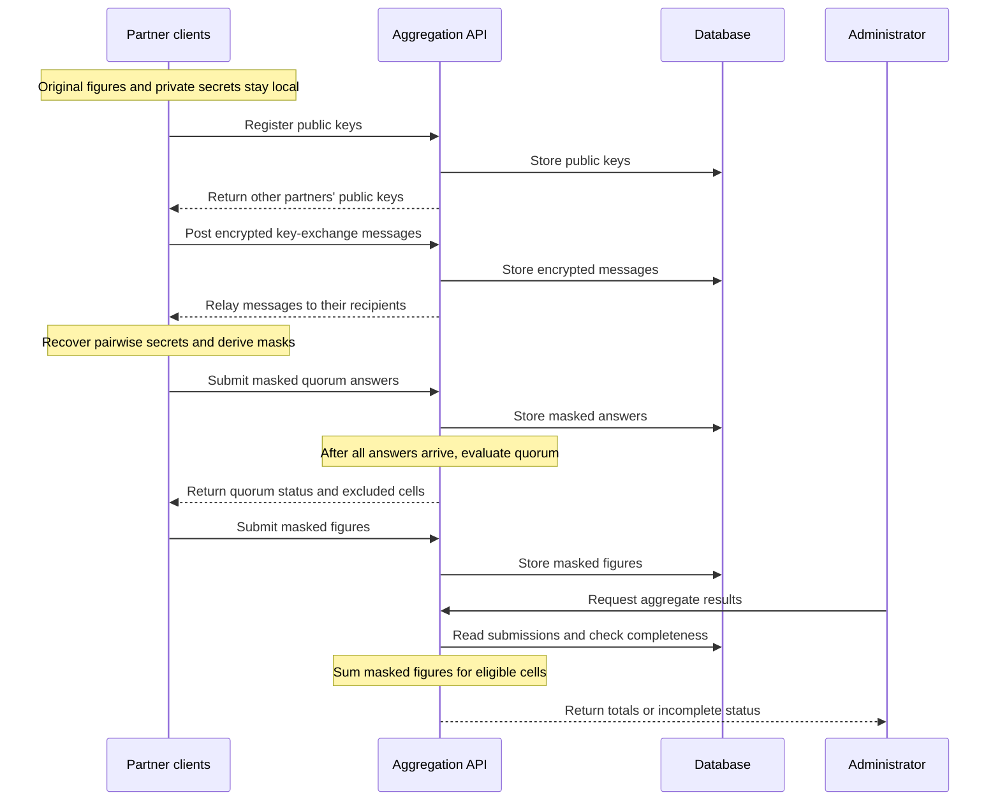

# Privacy-Preserving Secure Aggregation

This project enables the Development Data Partnership to aggregate AI token usage figures across providers by country, month, and category while protecting each partner's individual contribution, subject to the [privacy assumptions and limits](#privacy-assumptions-and-limits) below. Partners mask their figures locally before submission, and the aggregator will be able to recover the total figures for each cell by summing the masked submissions.

## Data sharing and visibility

Each partner keeps its original figures, private key, and shared secrets locally. Its client uses those secrets to mask participation answers and data contributions before submission.

The **aggregator** is the entity responsible for coordinating collection and combining contributions. In this project, that role belongs to the Development Data Partnership. Its aggregation service receives masked submissions alongside partner and cell identifiers, allowing it to organise contributions without receiving the original figures.

The Partnership receives aggregate results for eligible cells. It also knows the round's roster and submission progress. The [quorum check](#quorum-check) determines eligibility and is intended to support comparisons when the group of contributors changes. The [privacy assumptions and limits](#privacy-assumptions-and-limits) explain what protection these outputs provide.

## Reporting workflow

A **reporting round**, called an *epoch* in the code, has a fixed roster of partners and a defined set of **cells**. A cell identifies a combination of country, month, indicator, and category. A round can cover several reporting periods, such as several months of usage figures.

1. **Register and join a round.** Partners sign in through the organisation's identity service. An administrator selects the registered partners and the starting month.
2. **Establish shared secrets.** Clients exchange public keys and encrypted messages through the aggregation service to establish a secret for each pair of partners.
3. **Complete the quorum check.** Partners declare which cells they intend to contribute to, using masked answers.
4. **Submit masked figures.** Partners contribute only to cells they selected and that the quorum check found eligible.
5. **Calculate results.** The aggregation service combines the required submissions to recover each eligible cell's total.

## Secure aggregation

### Pairwise mask cancellation

Suppose three partners contribute token counts for the same cell. Each pair agrees on a mask: A–B uses 15, A–C uses 8, and B–C uses 4. One partner adds the pair's mask and the other subtracts it.

| Partner | Original count | Masks applied | Submitted count |
| --- | ---: | --- | ---: |
| A | 100 | +15 +8 | 123 |
| B | 50 | −15 +4 | 39 |
| C | 20 | −8 −4 | 8 |
| **Total** | **170** | **0** | **170** |

The aggregator receives 123, 39, and 8. Adding them gives 170 because every mask appears once with each sign. These small masks illustrate cancellation.

### Shared-secret establishment

Matching masks must be computable by the two partners involved, while remaining hidden from the aggregator. Each pair therefore establishes a **shared secret**, a value that only those two clients should know, and uses it to derive masks for their cells.

The aggregation service relays the messages needed to establish these secrets. Partners do not need a direct connection to one another or secrets agreed in advance. Each client's private key stays local, allowing it to recover shared secrets from the relayed messages. The [technical design](#technical-design) explains the cryptographic mechanism used for this exchange.

### Modulo arithmetic

The implementation uses large masks to hide each partner's figures. Calculations stay within a fixed 64-bit range using **modulo arithmetic**: values that pass either end of the range continue from the other end. This prevents the size of a masked value from exposing the original figure, while allowing matching positive and negative masks to cancel exactly. The aggregator recovers the correct total as long as that total fits within the supported range.

## Quorum check

The quorum check establishes which cells have at least three contributing partners and can be included in the results. It is designed to allow partners to contribute in some countries or categories and opt out of others without directly disclosing those choices to the Partnership.

Before submitting usage figures, every partner provides an answer for each cell: `1` if it intends to contribute and `0` if it does not. The client masks these answers before sending them to the aggregation service. Once all partners have answered, the masks cancel in the sum, giving the contributor count for each cell. Cells below the threshold are excluded from the list of index candidates.

A second purpose is to identify changes in the group of contributors between reporting periods or indicators, such as country, industry classification, model region of origin, and model access type. The Partnership should learn that the group changed without learning which partners joined or left. This helps it interpret rankings and growth measures, because a difference in the results may reflect different contributors rather than a change in usage.

Comparison across separate reporting rounds is an intended requirement whose support is not established by the current code. The [technical explanation](#quorum-representation) distinguishes the implemented within-round comparison from that requirement.

## Technical design

The implementation uses .NET 10 and React. Partners authenticate through Microsoft Entra ID and complete the protocol in their browser. The API and shared library implement the server-side workflow and cryptographic helpers described below.

### System architecture

| Component | Responsibility |
| --- | --- |
| Partner client | Holds original figures and private keys, establishes shared secrets, and masks participation answers and figures locally. |
| ASP.NET Core API | Manages rounds, relays key-exchange messages, validates submissions, and calculates results on behalf of the aggregator. |
| SQL Server / Azure SQL database | Stores partner records, rounds, public keys, encrypted key-exchange messages, masked answers, and masked figures. |
| Microsoft Entra ID | Supplies identity tokens and group membership used to distinguish partners and administrators. |
| Shared C# library | Defines data models, the collection schema, key-exchange and masking helpers, and participation evaluation. |

The [API project](AIRoundTableSecretSharingAPI/) and [shared library](AIRoundTableSecretSharingCommon/) contain the implementation. The [cell schema][schema] defines the country, month, indicator, and category combinations accepted by the current API. The code calls the category field `segment`.

### Aggregator data flow

The diagram follows messages through the aggregator's service. Original figures, private keys, and shared secrets remain in partner clients. Figure submissions follow the intended selection rule described in [Reporting workflow](#reporting-workflow).



### ML-KEM key establishment

**ML-KEM** stands for *Module-Lattice-Based Key-Encapsulation Mechanism*. It is standardised in [NIST FIPS 203][fips203] and establishes a shared secret using a public key and an encrypted message, called a **ciphertext**. This implementation uses the ML-KEM-768 parameter set.

For each pair, compare partner IDs using ordinal string ordering. The partner with the larger ID creates the ciphertext for the smaller one. For example, B creates a message for A:

1. A generates a key pair locally and registers its public key. Its private key stays local.
2. B retrieves A's public key and calls **encapsulation**, producing a shared secret and a ciphertext. B keeps the secret and posts the ciphertext to the API.
3. A retrieves the ciphertext and calls **decapsulation** with its private key, recovering the same secret.
4. Both clients use that secret to derive their matching masks. The aggregator holds the public key and ciphertext, which do not enable it to recover the secret under the mechanism's security assumptions.

See the [ML-KEM helper][kem], [key registration][keys], and [ciphertext relay][ciphertexts]. Registration and relay requests include epoch and device identifiers so the records can be associated with the relevant round and client state.

ML-KEM was selected for its intended resistance to attacks using quantum computers. NIST describes its security as related to the difficulty of the Module Learning with Errors problem. This is a property of the key-establishment mechanism, rather than a security guarantee for every component of the application. See [FIPS 203][fips203].

### Mask derivation and arithmetic

The [masking helper][masks] derives each pair's mask from its shared secret and the cell identifiers:

- Encode `country|month|indicator|segment` as UTF-8, with the month in `YYYY-MM` format.
- Apply HMAC-SHA256 using the shared secret as the key. HMAC is a keyed function that allows both partners to calculate the same output independently.
- Interpret the first eight output bytes as a signed 64-bit integer. The C# helper uses `BitConverter.ToInt64`, which follows the host's byte order. The intended little-endian format must be matched by other clients.
- The smaller partner ID adds the mask and the larger subtracts it. All clients must agree on identifiers, formatting, byte order, and sign ordering.

Masking and summation use arithmetic modulo 2⁶⁴. With a uniformly random mask in this range, each possible masked value is equally likely regardless of the original figure. Here, HMAC derives masks that are intended to be computationally indistinguishable from random values while the shared secret remains unknown.

The same arithmetic cancels every pair's masks, even when intermediate calculations exceed the signed integer range. The recovered total must fit within a signed 64-bit integer for the output to represent the intended total.

### Quorum representation

The [quorum request model][quorum-model] contains three masked values per cell: the yes/no flag and that flag multiplied by each of two secret random 64-bit tags. To compare contributor groups within a round, a compatible client must use consistent tags across the cells being compared.

The [quorum controller][quorum] accepts answers only after key exchange is complete and requires each partner's answer batch to cover the full cell grid. [Quorum evaluation][quorum-grid] waits for all answers, sums the flags to determine contributor counts, and combines the two tag sums into a 128-bit composition fingerprint called `Signature` in the response. Matching fingerprints are intended to indicate matching contributor groups, although collisions are possible.

The evaluation operates on one epoch at a time. Comparing fingerprints across epochs would require a consistent tagging convention across those epochs, which this code does not establish. Until that convention is verified, cross-round comparison remains an intended requirement rather than a demonstrated capability.

The client must use separate masks for the flag, each tag quantity, and usage figures. Reusing a mask for different underlying values can expose relationships between them. The server receives only masked answers and cannot verify that the flags are 0 or 1 or that tags were generated correctly.

### Cryptographic choices

| Purpose | Choice | Rationale |
| --- | --- | --- |
| Establish pairwise secrets | ML-KEM-768 | A standardised key-encapsulation mechanism selected for resistance to quantum attacks. |
| Derive per-cell masks | HMAC-SHA256 | Lets partners independently derive matching masks from a secret and a cell identifier. |
| Apply and cancel masks | Arithmetic modulo 2⁶⁴ | Keeps calculations in a fixed range while preserving exact cancellation. |
| Authenticate requests | Microsoft Entra ID bearer tokens | Associates API calls with identities and group-based permissions. |

Implementation links are pinned to a published commit so their code stays stable. Update the references when the documented behaviour changes.

## Security properties and limitations

### Privacy assumptions and limits

The intended protection assumes that the aggregator follows the protocol, even if it tries to learn individual figures from the messages it receives. Partners must use a correct client and keep local secrets private. This model is often called **honest-but-curious**. An aggregator that substitutes public keys, changes the roster, or modifies client software is outside that assumption.

### Security properties

Under those assumptions, the design provides the following protections:

| Property | How it is provided |
| --- | --- |
| Original figures remain local | Clients mask figures before sending them to the aggregation service. |
| The aggregator cannot derive individual pairwise masks from the relayed exchange alone | Private keys and shared secrets remain local, while the service holds public keys and ciphertexts. |
| Eligible totals are recovered exactly | Positive and negative masks cancel when all required submissions are summed using the agreed arithmetic. |
| Access and contribution roles are separated | [API policies][auth] allow administrators to manage rounds but exclude their accounts from contributing keys, quorum answers, or figures. Partners [register][registration] before being selected for a round. |
| Cells below the contribution threshold are excluded | The quorum result marks those cells as ignored, and the result endpoints withhold their totals. |

These are the design's protections under the stated conditions. Using a standard cryptographic primitive does not establish the security of the complete application.

### Limitations

- **Collusion and other knowledge can expose a contribution.** If everyone except one contributor shares their figures, they can subtract those figures from the total to recover the remaining contribution. A minimum of three contributors does not eliminate this risk.
- **Exact totals disclose information.** Comparing totals across overlapping groups or combining them with known figures can reveal individual values. The system does not add statistical noise to the released result.
- **Quorum results can reveal participation choices.** The Partnership knows the round roster and who completed the check. If a cell's count equals the roster size, the count reveals that every partner contributes to it. Other knowledge can also allow inferences.
- **Missing contributions prevent cancellation.** The protocol has no dropout recovery. An administrator can cancel and recreate an unfinished round, but cannot reconstruct a missing partner's masks.
- **Masked values cannot be checked for truthfulness.** The API validates identity, request format, and round membership. It cannot prove that a masked figure is accurate or that a quorum answer was formed honestly.
- **Local state must remain private and available.** A compromised client can expose figures or secrets. Losing keys or secrets after exchange starts may require restarting the round, because the aggregation service cannot recover them.

The unresolved cross-round comparison requirement is described in the quorum sections above. It is an implementation issue, separate from these protocol limitations.

## Running the system

### Prerequisites

- .NET 10 SDK
- Node.js 20+ for the React web UI
- Access to an Azure SQL database
- A Microsoft Entra ID tenant with API and web UI app registrations, an administrator security group, and a partner security group

Configure the API in `AIRoundTableSecretSharingAPI/appsettings.json` or through the environment variables below. Environment variables override the corresponding application settings.

| Application setting | Environment variable |
| --- | --- |
| `AzureAd:Instance` | `AzureAd__Instance` |
| `AzureAd:TenantId` | `AzureAd__TenantId` |
| `AzureAd:ClientId` | `AzureAd__ClientId` |
| `AzureAd:AdminGroupId` | `AzureAd__AdminGroupId` |
| `AzureAd:PartnerGroupId` | `AzureAd__PartnerGroupId` |
| `ConnectionStrings:DefaultConnection` | `ConnectionStrings__DefaultConnection` |
| `Cors:AllowedOrigins` | `Cors__AllowedOrigins` |

Use `https://login.microsoftonline.com/` for `AzureAd:Instance`, the tenant and API app IDs for their respective settings, and the security groups' object IDs for the group settings. `Cors:AllowedOrigins` accepts a comma-separated list of browser client origins. Keep credentials in local configuration or hosting settings rather than committing them.

The web UI uses its own app registration through `VITE_MSAL_CLIENT_ID`. Its `VITE_ADMIN_GROUP_ID` and `VITE_PARTNER_GROUP_ID` values should match the API's group IDs.

### Run the API

```sh
cd AIRoundTableSecretSharingAPI
dotnet run
```

The API runs on `http://localhost:5149`. It [applies Entity Framework Core database migrations automatically at startup][startup].

## Related concepts

- **Secure multi-party computation (MPC)** covers joint computation on inputs held by different parties. Secure aggregation is a specialised task in this broader field, focused here on calculating sums.
- **Differential privacy** bounds what a released result reveals about a contribution, commonly using calibrated statistical noise. Secure aggregation protects individual inputs during aggregation. This project does not implement differential privacy for its released totals. See [NIST's differential privacy guidance][dp].
- **Secret sharing**, including Shamir's scheme, divides a secret into shares that can be reconstructed by an authorised combination of holders. This protocol instead masks figures using pairwise secrets and does not implement Shamir reconstruction or dropout recovery.
- **Homomorphic encryption** supports operations on encrypted values. This project calculates sums through cancelling masks rather than homomorphic encryption of the usage figures.
- **Federated learning** trains models using data held by different participants and can use secure aggregation to combine their updates. [Bonawitz and colleagues' secure aggregation research][secure-aggregation-research] provides related background, but this repository does not implement every feature of that protocol.

[kem]: https://github.com/datapartnership/AIRoundTableSecretSharing/blob/c6384e494cb5477663f82a41e4cfcef99721272c/AIRoundTableSecretSharingCommon/Core/MlKemKeyExchange.cs#L18-L43
[masks]: https://github.com/datapartnership/AIRoundTableSecretSharing/blob/c6384e494cb5477663f82a41e4cfcef99721272c/AIRoundTableSecretSharingCommon/Core/SecureNoiseGenerator.cs#L19-L64
[schema]: https://github.com/datapartnership/AIRoundTableSecretSharing/blob/c6384e494cb5477663f82a41e4cfcef99721272c/AIRoundTableSecretSharingCommon/Models/EpochGrid.cs#L9-L31
[auth]: https://github.com/datapartnership/AIRoundTableSecretSharing/blob/c6384e494cb5477663f82a41e4cfcef99721272c/AIRoundTableSecretSharingAPI/Program.cs#L35-L49
[registration]: https://github.com/datapartnership/AIRoundTableSecretSharing/blob/c6384e494cb5477663f82a41e4cfcef99721272c/AIRoundTableSecretSharingAPI/Controllers/RegistryController.cs#L175-L211
[keys]: https://github.com/datapartnership/AIRoundTableSecretSharing/blob/c6384e494cb5477663f82a41e4cfcef99721272c/AIRoundTableSecretSharingAPI/Controllers/KeyExchangeController.cs#L67-L117
[ciphertexts]: https://github.com/datapartnership/AIRoundTableSecretSharing/blob/c6384e494cb5477663f82a41e4cfcef99721272c/AIRoundTableSecretSharingAPI/Controllers/CiphertextController.cs#L37-L109
[quorum]: https://github.com/datapartnership/AIRoundTableSecretSharing/blob/c6384e494cb5477663f82a41e4cfcef99721272c/AIRoundTableSecretSharingAPI/Controllers/QuorumController.cs#L43-L145
[quorum-grid]: https://github.com/datapartnership/AIRoundTableSecretSharing/blob/c6384e494cb5477663f82a41e4cfcef99721272c/AIRoundTableSecretSharingCommon/Models/QuorumGrid.cs#L17-L59
[results]: https://github.com/datapartnership/AIRoundTableSecretSharing/blob/c6384e494cb5477663f82a41e4cfcef99721272c/AIRoundTableSecretSharingAPI/Controllers/MetricsController.cs#L210-L301
[startup]: https://github.com/datapartnership/AIRoundTableSecretSharing/blob/c6384e494cb5477663f82a41e4cfcef99721272c/AIRoundTableSecretSharingAPI/Program.cs#L98-L115
[lifecycle]: https://github.com/datapartnership/AIRoundTableSecretSharing/blob/c6384e494cb5477663f82a41e4cfcef99721272c/AIRoundTableSecretSharingAPI/Services/EpochLifecycle.cs#L9-L38
[quorum-model]: https://github.com/datapartnership/AIRoundTableSecretSharing/blob/c6384e494cb5477663f82a41e4cfcef99721272c/AIRoundTableSecretSharingCommon/Models/QuorumResponse.cs#L28-L38
[fips203]: https://csrc.nist.gov/pubs/fips/203/final
[dp]: https://csrc.nist.gov/pubs/sp/800/226/final
[secure-aggregation-research]: https://research.google/pubs/practical-secure-aggregation-for-federated-learning-on-user-held-data/
